I started out in a neuroscience lab in Colorado, then spent nearly a decade before graduate school as a field technician on wolf, cougar, elk, deer, beaver, and predator-prey projects. Click a point on the map to see each position.

```{=html}
<div id="fieldmap" style="height: 460px; border: 1px solid #DAD5CB; border-radius: 6px; margin: 1rem 0 .5rem;"></div>
<p style="font-size:.9rem;color:#5E5B55;margin-bottom:1.5rem;">
  <span style="display:inline-block;width:.8rem;height:.8rem;border-radius:50%;background:#A9573A;vertical-align:middle;"></span> Past field projects
  &nbsp;&nbsp;
  <span style="display:inline-block;width:.8rem;height:.8rem;border-radius:50%;background:#4E3426;vertical-align:middle;"></span> Lab research
  &nbsp;&nbsp;
  <span style="display:inline-block;width:.8rem;height:.8rem;border-radius:50%;background:#4F5B45;vertical-align:middle;"></span> Current work and M.Sc. (Kelowna, BC)
  &nbsp;&nbsp;
  <span style="display:inline-block;width:1rem;height:.7rem;background:rgba(79,91,69,.25);border:1px solid #4F5B45;vertical-align:middle;"></span> Region of current work (BC and Alberta)
  &nbsp;&nbsp; Locations are approximate.
</p>
<script>
(function () {
  var sites = [
    {name: "Yellowstone Wolf, Cougar, and Elk Project Technician", lines: ["National Park Service", "Yellowstone National Park, Wyoming"], when: "Nov 2022 to Apr 2023", ll: [44.90, -110.30], now: false},
    {name: "Biological Science Technician, Wolf and Deer Project", lines: ["U.S. Geological Survey", "Ely, Minnesota"], when: "Jul 2020 to Aug 2022", ll: [47.90, -91.87], now: false},
    {name: "Isle Royale National Park, Michigan", lines: ["Biological Science Technician, National Park Service (May to Oct 2023)", "Lead Beaver Project Technician, National Park Service (Aug to Oct 2019 and 2022)", "Winter Study Technician, National Park Service (Mar 2020)", "Wolf Introduction Research Technician, SUNY ESF (May to Aug 2019)"], when: "2019 to 2023", ll: [48.00, -88.90], now: false},
    {name: "Mexican Wolf Recovery Program Field Technician", lines: ["U.S. Fish and Wildlife Service", "Alpine, Arizona"], when: "Oct 2018 to Apr 2019; Jan to May 2020", ll: [33.85, -109.13], now: false},
    {name: "Elk Calf Survival Study Technician", lines: ["New Mexico Department of Game and Fish", "Mount Taylor, New Mexico"], when: "May to Sep 2018", ll: [35.24, -107.61], now: false},
    {name: "Advanced Deer, CWD, and Predator-Prey Research Technician", lines: ["Wisconsin Department of Natural Resources", "Dodgeville, Wisconsin"], when: "Nov 2017 to May 2018", ll: [42.96, -90.13], now: false},
    {name: "Carnivore/Deer Wildlife Technician", lines: ["Mississippi State University", "Baraga, Michigan"], when: "Apr to Nov 2017", ll: [46.78, -88.49], now: false},
    {name: "Wildlife Monitoring Technician", lines: ["Lake County Forest Preserves", "Lake County, Illinois"], when: "May to Nov 2016", ll: [42.32, -87.98], now: false},
    {name: "Odonate Researcher", lines: ["McHenry County College and McHenry County Conservation District", "McHenry County, Illinois"], when: "Nov 2015 to Nov 2017", ll: [42.32, -88.45], now: false},
    {name: "Neuroscience Laboratory Research Intern", lines: ["Dr. Curt Freed's laboratory", "Anschutz Medical Campus, Aurora, Colorado"], when: "Aug to Nov 2014", ll: [39.75, -104.84], now: false, lab: true},
    {now: true, ll: [49.89, -119.50], html: "<strong>M.Sc. in Biology</strong><br>University of British Columbia Okanagan, Kelowna, BC<br><em>2024 to present</em><br>Study area: Columbia Mountains<br>Topic: White-tailed deer (sek̓wtúps) range expansion<br><br><strong>Applied Ecologist, SwampDonkey</strong><br>Wildlife and ecosystem research and monitoring with First Nations partners in British Columbia and Alberta<br><em>Aug 2026 to present</em>"}
  ];
  var map = L.map("fieldmap", {scrollWheelZoom: false, zoomSnap: 0.25});

  L.tileLayer("https://tile.openstreetmap.org/{z}/{x}/{y}.png", {
    maxZoom: 12,
    attribution: "&copy; <a href=\"https://www.openstreetmap.org/copyright\">OpenStreetMap</a> contributors"
  }).addTo(map);
  var pts = [];
  sites.forEach(function (s) {
    var m = L.circleMarker(s.ll, {radius: 8, weight: 2, color: "#ffffff", fillColor: s.now ? "#4F5B45" : (s.lab ? "#4E3426" : "#A9573A"), fillOpacity: 0.95});
    m.bindPopup(s.html ? s.html : "<strong>" + s.name + "</strong><br>" + s.lines.join("<br>") + (s.when ? "<br><em>" + s.when + "</em>" : ""));
    m.addTo(map); pts.push(s.ll);
  });
  var provinces = {"type":"FeatureCollection","features":[{"type":"Feature","properties":{"name":"Alberta"},"geometry":{"type":"Polygon","coordinates":[[[-109.999,48.993],[-110.321,48.993],[-110.748,48.993],[-111.174,48.993],[-111.6,48.993],[-112.027,48.993],[-112.453,48.993],[-112.88,48.993],[-113.306,48.993],[-113.732,48.993],[-114.063,48.993],[-114.051,49.015],[-114.057,49.038],[-114.133,49.094],[-114.164,49.147],[-114.19,49.168],[-114.355,49.211],[-114.378,49.232],[-114.386,49.252],[-114.426,49.274],[-114.48,49.333],[-114.565,49.394],[-114.588,49.42],[-114.59,49.452],[-114.576,49.519],[-114.577,49.544],[-114.602,49.551],[-114.681,49.556],[-114.717,49.569],[-114.734,49.587],[-114.737,49.604],[-114.686,49.643],[-114.643,49.73],[-114.638,49.797],[-114.685,49.934],[-114.678,49.955],[-114.651,49.985],[-114.652,50.02],[-114.668,50.061],[-114.716,50.129],[-114.789,50.359],[-114.993,50.545],[-115.048,50.577],[-115.091,50.585],[-115.128,50.585],[-115.189,50.557],[-115.206,50.554],[-115.222,50.563],[-115.267,50.594],[-115.305,50.635],[-115.311,50.642],[-115.308,50.656],[-115.298,50.673],[-115.311,50.697],[-115.335,50.72],[-115.347,50.729],[-115.36,50.729],[-115.376,50.727],[-115.386,50.726],[-115.399,50.731],[-115.433,50.756],[-115.634,50.855],[-115.64,50.869],[-115.588,50.909],[-115.596,50.936],[-115.619,50.962],[-115.794,51.07],[-115.94,51.102],[-115.998,51.13],[-116.014,51.151],[-116.035,51.218],[-116.042,51.23],[-116.054,51.237],[-116.135,51.266],[-116.176,51.297],[-116.25,51.323],[-116.279,51.348],[-116.31,51.448],[-116.377,51.497],[-116.411,51.544],[-116.458,51.574],[-116.502,51.615],[-116.567,51.651],[-116.634,51.758],[-116.674,51.791],[-116.718,51.8],[-116.758,51.789],[-116.791,51.771],[-116.808,51.753],[-116.815,51.722],[-116.83,51.715],[-116.913,51.714],[-116.939,51.736],[-117.037,51.886],[-117.077,51.926],[-117.245,52.047],[-117.32,52.156],[-117.348,52.159],[-117.385,52.144],[-117.587,52.142],[-117.751,52.208],[-117.788,52.233],[-117.822,52.272],[-117.735,52.353],[-117.732,52.383],[-117.758,52.395],[-117.883,52.43],[-118.002,52.486],[-118.029,52.466],[-118.044,52.427],[-118.06,52.413],[-118.191,52.384],[-118.221,52.386],[-118.243,52.409],[-118.247,52.441],[-118.225,52.483],[-118.266,52.518],[-118.288,52.562],[-118.35,52.623],[-118.319,52.674],[-118.33,52.709],[-118.358,52.742],[-118.413,52.784],[-118.428,52.836],[-118.477,52.879],[-118.502,52.888],[-118.605,52.895],[-118.631,52.909],[-118.668,52.972],[-118.678,53.026],[-118.731,53.058],[-118.766,53.065],[-118.774,53.122],[-118.804,53.153],[-118.914,53.212],[-118.993,53.236],[-119.016,53.204],[-119.022,53.139],[-119.046,53.144],[-119.261,53.209],[-119.309,53.242],[-119.4,53.353],[-119.435,53.362],[-119.592,53.372],[-119.648,53.363],[-119.68,53.371],[-119.723,53.4],[-119.82,53.491],[-119.855,53.509],[-119.894,53.516],[-119.896,53.567],[-119.921,53.602],[-119.918,53.612],[-119.887,53.615],[-119.743,53.615],[-119.735,53.634],[-119.812,53.699],[-119.885,53.708],[-119.904,53.723],[-119.917,53.77],[-119.973,53.797],[-120.001,53.844],[-120.001,54.229],[-120.001,54.613],[-120.001,54.998],[-120.001,55.383],[-120.001,55.768],[-120.001,56.153],[-120.001,56.538],[-120.001,56.922],[-120.0,57.307],[-120.0,57.692],[-120.0,58.077],[-120.0,58.462],[-120.0,58.847],[-120.0,59.231],[-120.0,59.616],[-120,60.001],[-119.375,60.001],[-118.75,60.001],[-118.125,60.001],[-117.5,60.001],[-116.875,60.001],[-116.25,60.001],[-115.625,60.001],[-115.0,60.001],[-114.375,60.001],[-113.75,60.001],[-113.125,60.001],[-112.5,60.001],[-111.875,60.001],[-111.25,60.001],[-110.625,60.001],[-110.0,60.001],[-110,59.657],[-110.0,59.313],[-110.0,58.969],[-110.0,58.625],[-110.0,58.281],[-110.0,57.937],[-110.0,57.593],[-110.0,57.249],[-110.0,56.905],[-110.0,56.561],[-110.0,56.217],[-110.0,55.873],[-110.0,55.529],[-110.0,55.185],[-110.0,54.842],[-110.0,54.498],[-110.0,54.154],[-110.0,53.81],[-110.0,53.466],[-110.0,53.122],[-110.0,52.778],[-110.0,52.434],[-110.0,52.09],[-110.0,51.746],[-110.0,51.402],[-110.0,51.058],[-110.0,50.714],[-109.999,50.37],[-109.999,50.026],[-109.999,49.682],[-109.999,49.338],[-109.999,48.993]]]}},{"type":"Feature","properties":{"name":"British Columbia"},"geometry":{"type":"MultiPolygon","coordinates":[[[[-120,60.001],[-120.0,59.616],[-120.0,59.231],[-120.0,58.847],[-120.0,58.462],[-120.0,58.077],[-120.0,57.692],[-120.0,57.307],[-120.001,56.922],[-120.001,56.538],[-120.001,56.153],[-120.001,55.768],[-120.001,55.383],[-120.001,54.998],[-120.001,54.613],[-120.001,54.229],[-120.001,53.844],[-119.973,53.797],[-119.917,53.77],[-119.904,53.723],[-119.885,53.708],[-119.812,53.699],[-119.735,53.634],[-119.743,53.615],[-119.887,53.615],[-119.918,53.612],[-119.921,53.602],[-119.896,53.567],[-119.894,53.516],[-119.855,53.509],[-119.82,53.491],[-119.723,53.4],[-119.68,53.371],[-119.648,53.363],[-119.592,53.372],[-119.435,53.362],[-119.4,53.353],[-119.309,53.242],[-119.261,53.209],[-119.046,53.144],[-119.022,53.139],[-119.016,53.204],[-118.993,53.236],[-118.914,53.212],[-118.804,53.153],[-118.774,53.122],[-118.766,53.065],[-118.731,53.058],[-118.678,53.026],[-118.668,52.972],[-118.631,52.909],[-118.605,52.895],[-118.502,52.888],[-118.477,52.879],[-118.428,52.836],[-118.413,52.784],[-118.358,52.742],[-118.33,52.709],[-118.319,52.674],[-118.35,52.623],[-118.288,52.562],[-118.266,52.518],[-118.225,52.483],[-118.247,52.441],[-118.243,52.409],[-118.221,52.386],[-118.191,52.384],[-118.06,52.413],[-118.044,52.427],[-118.029,52.466],[-118.002,52.486],[-117.883,52.43],[-117.758,52.395],[-117.732,52.383],[-117.735,52.353],[-117.822,52.272],[-117.788,52.233],[-117.751,52.208],[-117.587,52.142],[-117.385,52.144],[-117.348,52.159],[-117.32,52.156],[-117.245,52.047],[-117.077,51.926],[-117.037,51.886],[-116.939,51.736],[-116.913,51.714],[-116.83,51.715],[-116.815,51.722],[-116.808,51.753],[-116.791,51.771],[-116.758,51.789],[-116.718,51.8],[-116.674,51.791],[-116.634,51.758],[-116.567,51.651],[-116.502,51.615],[-116.458,51.574],[-116.411,51.544],[-116.377,51.497],[-116.31,51.448],[-116.279,51.348],[-116.25,51.323],[-116.176,51.297],[-116.135,51.266],[-116.054,51.237],[-116.042,51.23],[-116.035,51.218],[-116.014,51.151],[-115.998,51.13],[-115.94,51.102],[-115.794,51.07],[-115.619,50.962],[-115.596,50.936],[-115.588,50.909],[-115.64,50.869],[-115.634,50.855],[-115.433,50.756],[-115.399,50.731],[-115.386,50.726],[-115.376,50.727],[-115.36,50.729],[-115.347,50.729],[-115.335,50.72],[-115.311,50.697],[-115.298,50.673],[-115.308,50.656],[-115.311,50.642],[-115.305,50.635],[-115.267,50.594],[-115.222,50.563],[-115.206,50.554],[-115.189,50.557],[-115.128,50.585],[-115.091,50.585],[-115.048,50.577],[-114.993,50.545],[-114.789,50.359],[-114.716,50.129],[-114.668,50.061],[-114.652,50.02],[-114.651,49.985],[-114.678,49.955],[-114.685,49.934],[-114.638,49.797],[-114.643,49.73],[-114.686,49.643],[-114.737,49.604],[-114.734,49.587],[-114.717,49.569],[-114.681,49.556],[-114.602,49.551],[-114.577,49.544],[-114.576,49.519],[-114.59,49.452],[-114.588,49.42],[-114.565,49.394],[-114.48,49.333],[-114.426,49.274],[-114.386,49.252],[-114.378,49.232],[-114.355,49.211],[-114.19,49.168],[-114.164,49.147],[-114.133,49.094],[-114.057,49.038],[-114.051,49.015],[-114.063,48.993],[-114.159,48.993],[-114.585,48.993],[-115.011,48.993],[-115.438,48.993],[-115.864,48.993],[-116.048,48.993],[-116.291,48.993],[-116.717,48.993],[-117.039,48.993],[-117.143,48.993],[-117.57,48.993],[-117.996,48.993],[-118.423,48.993],[-118.849,48.993],[-119.275,48.993],[-119.702,48.993],[-120.128,48.993],[-120.554,48.993],[-120.981,48.993],[-121.407,48.993],[-121.834,48.993],[-122.26,48.993],[-122.686,48.993],[-122.789,48.993],[-122.827,49.028],[-122.924,49.075],[-122.963,49.075],[-123.002,49.061],[-123.027,49.039],[-123.049,48.993],[-123.086,48.993],[-123.118,49.056],[-123.109,49.085],[-123.077,49.118],[-123.08,49.131],[-123.15,49.121],[-123.182,49.13],[-123.196,49.148],[-123.191,49.22],[-123.229,49.261],[-123.184,49.278],[-123.067,49.292],[-122.948,49.293],[-122.913,49.323],[-122.879,49.399],[-122.964,49.329],[-123.016,49.322],[-123.174,49.348],[-123.277,49.344],[-123.291,49.359],[-123.286,49.375],[-123.264,49.39],[-123.248,49.443],[-123.223,49.59],[-123.191,49.644],[-123.18,49.674],[-123.187,49.68],[-123.325,49.578],[-123.337,49.545],[-123.322,49.517],[-123.336,49.459],[-123.399,49.442],[-123.437,49.451],[-123.508,49.402],[-123.531,49.397],[-123.859,49.483],[-123.892,49.495],[-123.948,49.535],[-124.029,49.603],[-124.054,49.662],[-124.024,49.711],[-123.993,49.736],[-123.96,49.736],[-123.923,49.718],[-123.847,49.637],[-123.817,49.587],[-123.739,49.594],[-123.613,49.658],[-123.582,49.681],[-123.708,49.657],[-123.763,49.659],[-123.818,49.685],[-123.874,49.737],[-123.904,49.795],[-123.904,49.981],[-123.885,50.017],[-123.824,50.044],[-123.785,50.088],[-123.788,50.107],[-123.825,50.144],[-123.88,50.174],[-123.934,50.188],[-123.946,50.184],[-123.863,50.103],[-123.866,50.072],[-123.957,49.993],[-123.971,49.97],[-123.972,49.892],[-123.985,49.876],[-124.059,49.854],[-124.142,49.793],[-124.281,49.772],[-124.413,49.778],[-124.483,49.808],[-124.702,49.958],[-124.782,50.02],[-124.784,50.073],[-124.934,50.258],[-124.933,50.298],[-124.986,50.356],[-125.044,50.364],[-125.057,50.419],[-124.937,50.537],[-124.863,50.637],[-124.854,50.669],[-124.858,50.717],[-124.875,50.826],[-124.86,50.872],[-124.934,50.811],[-124.949,50.765],[-124.931,50.718],[-124.943,50.666],[-124.985,50.592],[-125.059,50.514],[-125.21,50.476],[-125.476,50.497],[-125.507,50.507],[-125.526,50.534],[-125.539,50.649],[-125.556,50.635],[-125.586,50.574],[-125.61,50.486],[-125.641,50.466],[-125.698,50.465],[-125.741,50.479],[-125.772,50.508],[-125.84,50.511],[-125.965,50.487],[-126.024,50.497],[-126.094,50.498],[-126.237,50.523],[-126.404,50.53],[-126.45,50.55],[-126.447,50.588],[-126.416,50.607],[-126.239,50.624],[-126.067,50.664],[-125.898,50.684],[-125.904,50.705],[-125.981,50.711],[-126.37,50.667],[-126.493,50.672],[-126.514,50.679],[-126.517,50.724],[-126.472,50.767],[-126.397,50.807],[-126.375,50.837],[-126.418,50.85],[-126.488,50.842],[-126.522,50.866],[-126.485,50.961],[-126.517,51.057],[-126.563,50.965],[-126.632,50.915],[-126.96,50.894],[-127.014,50.867],[-127.058,50.868],[-127.267,50.916],[-127.357,50.946],[-127.441,50.989],[-127.591,51.088],[-127.708,51.151],[-127.714,51.269],[-127.689,51.343],[-127.633,51.427],[-127.42,51.608],[-127.347,51.642],[-127.281,51.654],[-126.968,51.67],[-126.735,51.693],[-126.691,51.703],[-127.034,51.717],[-127.339,51.707],[-127.443,51.679],[-127.576,51.563],[-127.61,51.514],[-127.645,51.478],[-127.669,51.478],[-127.714,51.49],[-127.729,51.506],[-127.748,51.544],[-127.819,51.604],[-127.851,51.673],[-127.869,51.775],[-127.863,51.821],[-127.83,51.879],[-127.728,51.993],[-127.859,51.99],[-127.843,52.086],[-127.795,52.191],[-127.673,52.253],[-127.55,52.298],[-127.438,52.356],[-127.242,52.395],[-127.176,52.315],[-127.008,52.291],[-126.959,52.255],[-126.9,52.188],[-126.826,52.125],[-126.739,52.065],[-126.714,52.061],[-126.753,52.112],[-126.895,52.225],[-126.901,52.265],[-126.938,52.309],[-127.127,52.371],[-127.161,52.395],[-127.194,52.458],[-127.208,52.498],[-127.187,52.538],[-126.995,52.658],[-126.951,52.721],[-126.951,52.751],[-126.966,52.785],[-127.008,52.843],[-127.019,52.842],[-127.006,52.755],[-127.013,52.72],[-127.035,52.682],[-127.066,52.653],[-127.107,52.633],[-127.519,52.359],[-127.56,52.343],[-127.713,52.319],[-127.792,52.289],[-127.834,52.251],[-127.902,52.151],[-127.995,51.951],[-128.102,51.788],[-128.194,51.998],[-128.358,52.159],[-128.037,52.318],[-128.029,52.342],[-128.06,52.428],[-128.052,52.453],[-128.021,52.491],[-127.94,52.545],[-127.943,52.551],[-128.038,52.531],[-128.184,52.408],[-128.241,52.368],[-128.272,52.363],[-128.275,52.436],[-128.197,52.623],[-128.132,52.806],[-128.109,52.858],[-128.053,52.911],[-128.106,52.907],[-128.365,52.826],[-128.452,52.877],[-128.525,53.141],[-128.652,53.244],[-128.869,53.328],[-129.081,53.367],[-129.13,53.442],[-129.172,53.534],[-129.114,53.641],[-129.021,53.692],[-128.936,53.715],[-128.855,53.705],[-128.85,53.665],[-128.906,53.559],[-128.833,53.549],[-128.542,53.421],[-128.479,53.41],[-128.358,53.46],[-128.291,53.458],[-128.133,53.418],[-128.079,53.369],[-127.928,53.275],[-127.95,53.33],[-128.115,53.446],[-128.207,53.483],[-128.369,53.49],[-128.47,53.471],[-128.512,53.477],[-128.6,53.506],[-128.676,53.555],[-128.751,53.661],[-128.768,53.71],[-128.764,53.747],[-128.746,53.78],[-128.715,53.81],[-128.653,53.832],[-128.56,53.845],[-128.532,53.858],[-128.651,53.919],[-128.705,53.919],[-128.89,53.83],[-128.928,53.823],[-128.944,53.84],[-128.959,53.841],[-129.014,53.797],[-129.056,53.778],[-129.208,53.642],[-129.232,53.576],[-129.24,53.479],[-129.258,53.418],[-129.284,53.393],[-129.462,53.347],[-129.564,53.251],[-129.687,53.334],[-129.822,53.413],[-129.912,53.551],[-130.074,53.576],[-130.263,53.654],[-130.335,53.724],[-130.233,53.867],[-130.086,53.976],[-130.064,54.106],[-130.043,54.134],[-129.791,54.166],[-129.626,54.23],[-129.795,54.236],[-129.898,54.226],[-130.084,54.181],[-130.29,54.27],[-130.397,54.352],[-130.43,54.421],[-130.393,54.48],[-130.389,54.539],[-130.37,54.62],[-130.35,54.655],[-130.307,54.7],[-130.219,54.73],[-130.141,54.823],[-130.109,54.887],[-129.949,55.081],[-129.89,55.165],[-129.781,55.28],[-129.561,55.463],[-129.63,55.452],[-129.667,55.437],[-129.701,55.439],[-129.734,55.458],[-129.765,55.498],[-129.795,55.56],[-129.812,55.533],[-129.816,55.418],[-129.838,55.319],[-129.877,55.251],[-129.985,55.111],[-130.048,55.057],[-130.092,55.108],[-130.058,55.195],[-129.996,55.264],[-129.985,55.359],[-130.044,55.472],[-130.08,55.563],[-130.093,55.632],[-130.095,55.695],[-130.085,55.752],[-130.06,55.814],[-130.02,55.881],[-130.025,55.888],[-130.014,55.951],[-130.023,56.015],[-130.056,56.065],[-130.098,56.109],[-130.215,56.083],[-130.413,56.123],[-130.477,56.231],[-130.649,56.264],[-130.742,56.341],[-130.93,56.379],[-131.083,56.405],[-131.199,56.449],[-131.336,56.501],[-131.472,56.557],[-131.575,56.599],[-131.652,56.596],[-131.824,56.59],[-131.833,56.685],[-131.886,56.742],[-131.866,56.793],[-131.963,56.819],[-132.104,56.857],[-132.063,56.953],[-132.032,57.027],[-132.157,57.048],[-132.338,57.079],[-132.279,57.145],[-132.232,57.199],[-132.302,57.276],[-132.442,57.407],[-132.55,57.5],[-132.692,57.645],[-132.816,57.773],[-132.917,57.877],[-133.001,57.949],[-133.12,58.078],[-133.275,58.223],[-133.423,58.337],[-133.401,58.411],[-133.546,58.503],[-133.674,58.597],[-133.821,58.705],[-133.966,58.758],[-134.069,58.796],[-134.219,58.85],[-134.297,58.898],[-134.33,58.94],[-134.364,58.969],[-134.393,59.009],[-134.41,59.056],[-134.441,59.085],[-134.622,59.155],[-134.677,59.199],[-134.802,59.25],[-134.907,59.271],[-134.944,59.288],[-135.071,59.441],[-135.051,59.496],[-135.037,59.551],[-135.051,59.579],[-135.261,59.695],[-135.368,59.743],[-135.476,59.793],[-135.703,59.729],[-135.935,59.663],[-136.097,59.638],[-136.322,59.605],[-136.247,59.533],[-136.278,59.48],[-136.348,59.456],[-136.466,59.459],[-136.467,59.28],[-136.579,59.152],[-136.813,59.15],[-136.939,59.106],[-137.126,59.041],[-137.278,58.988],[-137.439,58.903],[-137.521,58.915],[-137.484,58.991],[-137.544,59.119],[-137.593,59.226],[-137.697,59.281],[-137.871,59.374],[-138.001,59.443],[-138.187,59.542],[-138.318,59.611],[-138.454,59.683],[-138.632,59.778],[-138.705,59.901],[-138.869,59.946],[-139.043,59.993],[-139.057,60.002],[-138.095,60.001],[-137.144,60.001],[-136.192,60.001],[-135.24,60.001],[-134.288,60.001],[-133.337,60.001],[-132.385,60.001],[-131.433,60.001],[-130.481,60.001],[-129.53,60.001],[-128.578,60.001],[-127.626,60.001],[-126.674,60.001],[-125.723,60.001],[-124.771,60.001],[-123.819,60.001],[-123.342,60.001],[-122.864,60.001],[-122.387,60.001],[-121.91,60.001],[-121.432,60.001],[-120.955,60.001],[-120.477,60.001],[-120,60.001]]],[[[-130.214,55.026],[-130.219,55.06],[-130.172,55.137],[-130.037,55.298],[-130.039,55.344],[-130.059,55.412],[-130.12,55.524],[-130.14,55.585],[-130.147,55.654],[-130.137,55.719],[-130.112,55.78],[-130.075,55.836],[-130.025,55.888],[-130.092,55.786],[-130.123,55.691],[-130.11,55.581],[-130.069,55.483],[-130.038,55.416],[-130.022,55.372],[-130.015,55.332],[-130.018,55.285],[-130.064,55.226],[-130.214,55.026]]],[[[-130.214,55.026],[-130.204,54.947],[-130.349,54.815],[-130.535,54.749],[-130.575,54.77],[-130.493,54.834],[-130.313,54.946],[-130.214,55.026]]],[[[-130.927,54.479],[-130.95,54.478],[-130.959,54.499],[-130.953,54.542],[-130.922,54.615],[-130.907,54.632],[-130.777,54.619],[-130.758,54.614],[-130.753,54.6],[-130.763,54.577],[-130.805,54.544],[-130.927,54.479]]],[[[-132.656,54.127],[-132.564,54.069],[-132.344,54.106],[-132.303,54.099],[-132.262,54.076],[-132.216,54.028],[-132.166,53.955],[-132.155,53.875],[-132.175,53.847],[-132.215,53.815],[-132.565,53.688],[-132.574,53.675],[-132.567,53.664],[-132.535,53.652],[-132.464,53.653],[-132.187,53.685],[-132.172,53.707],[-132.152,53.807],[-132.114,53.86],[-132.111,53.9],[-132.136,53.996],[-132.134,54.034],[-131.941,54.042],[-131.82,54.077],[-131.696,54.143],[-131.668,54.141],[-131.685,54.023],[-131.703,53.986],[-131.821,53.842],[-131.889,53.714],[-131.922,53.588],[-131.928,53.379],[-131.957,53.309],[-132.011,53.265],[-132.347,53.189],[-132.52,53.194],[-132.675,53.263],[-132.748,53.31],[-132.693,53.368],[-132.655,53.371],[-132.546,53.359],[-132.462,53.338],[-132.425,53.337],[-132.431,53.35],[-132.67,53.459],[-132.845,53.508],[-132.898,53.563],[-132.9,53.605],[-132.913,53.629],[-133.052,53.778],[-133.079,53.837],[-133.098,53.92],[-133.098,54.006],[-133.064,54.144],[-133.048,54.159],[-132.991,54.158],[-132.893,54.141],[-132.656,54.127]]],[[[-130.236,53.959],[-130.267,53.923],[-130.338,53.866],[-130.384,53.844],[-130.407,53.856],[-130.47,53.862],[-130.537,53.918],[-130.59,53.94],[-130.625,53.941],[-130.642,53.921],[-130.646,53.894],[-130.638,53.86],[-130.644,53.845],[-130.664,53.848],[-130.683,53.863],[-130.703,53.892],[-130.707,53.921],[-130.696,53.951],[-130.647,53.991],[-130.495,54.074],[-130.448,54.089],[-130.397,54.086],[-130.316,54.047],[-130.299,54.036],[-130.236,53.959]]],[[[-129.849,53.168],[-129.869,53.165],[-129.934,53.177],[-130.151,53.346],[-130.306,53.407],[-130.411,53.491],[-130.518,53.544],[-130.452,53.631],[-130.395,53.62],[-130.195,53.55],[-130.035,53.481],[-129.945,53.436],[-129.755,53.245],[-129.769,53.217],[-129.849,53.168]]],[[[-129.168,53.118],[-129.173,53.111],[-129.277,53.111],[-129.306,53.121],[-129.324,53.142],[-129.331,53.174],[-129.314,53.212],[-129.253,53.285],[-129.251,53.317],[-129.238,53.33],[-129.195,53.293],[-129.177,53.259],[-129.168,53.118]]],[[[-128.552,52.94],[-128.507,52.621],[-128.51,52.519],[-128.577,52.452],[-128.624,52.34],[-128.679,52.29],[-128.731,52.357],[-128.736,52.468],[-128.749,52.556],[-128.766,52.598],[-128.746,52.763],[-128.77,52.751],[-128.831,52.679],[-128.9,52.674],[-129.023,52.756],[-129.085,52.822],[-129.095,52.892],[-129.176,52.965],[-129.184,52.991],[-129.178,53.018],[-129.111,53.091],[-129.084,53.14],[-129.06,53.241],[-129.033,53.28],[-128.97,53.274],[-128.858,53.229],[-128.74,53.179],[-128.633,53.113],[-128.552,52.94]]],[[[-131.754,53.196],[-131.652,53.103],[-131.622,53.02],[-131.635,52.922],[-131.795,52.885],[-131.88,52.915],[-131.916,52.909],[-131.972,52.88],[-131.904,52.867],[-131.81,52.819],[-131.727,52.756],[-131.611,52.745],[-131.455,52.702],[-131.573,52.623],[-131.591,52.578],[-131.444,52.453],[-131.43,52.422],[-131.383,52.416],[-131.274,52.426],[-131.26,52.416],[-131.26,52.39],[-131.327,52.318],[-131.32,52.303],[-131.259,52.292],[-131.143,52.291],[-131.116,52.219],[-131.222,52.154],[-131.422,52.238],[-131.511,52.322],[-131.562,52.4],[-131.624,52.444],[-131.81,52.542],[-132.092,52.753],[-132.165,52.783],[-132.239,52.867],[-132.26,52.907],[-132.258,52.934],[-132.23,52.948],[-132.145,52.957],[-132.144,52.999],[-132.469,53.072],[-132.505,53.087],[-132.547,53.137],[-132.524,53.145],[-132.345,53.136],[-132.154,53.16],[-132.036,53.179],[-131.989,53.202],[-131.893,53.231],[-131.853,53.23],[-131.754,53.196]]],[[[-129.314,52.992],[-129.329,52.984],[-129.37,52.998],[-129.41,53.024],[-129.478,53.098],[-129.5,53.129],[-129.515,53.179],[-129.501,53.188],[-129.471,53.183],[-129.451,53.175],[-129.343,53.053],[-129.314,52.992]]],[[[-128.937,52.51],[-128.969,52.464],[-129.102,52.574],[-129.151,52.605],[-129.251,52.722],[-129.268,52.772],[-129.264,52.801],[-129.246,52.811],[-129.215,52.804],[-129.186,52.791],[-128.994,52.662],[-128.94,52.601],[-128.937,52.51]]],[[[-128.369,52.401],[-128.445,52.387],[-128.42,52.441],[-128.413,52.473],[-128.426,52.503],[-128.436,52.56],[-128.44,52.696],[-128.365,52.782],[-128.247,52.784],[-128.248,52.741],[-128.298,52.548],[-128.324,52.459],[-128.344,52.426],[-128.369,52.401]]],[[[-131.029,51.962],[-131.047,51.96],[-131.081,51.98],[-131.103,52.014],[-131.117,52.101],[-131.107,52.137],[-131.098,52.151],[-131.011,52.095],[-131.029,51.962]]],[[[-127.925,51.474],[-127.941,51.457],[-127.981,51.457],[-128.045,51.474],[-128.092,51.511],[-128.149,51.627],[-128.142,51.647],[-128.123,51.667],[-128.032,51.708],[-127.999,51.704],[-127.987,51.674],[-127.932,51.605],[-127.916,51.585],[-127.916,51.506],[-127.925,51.474]]],[[[-127.197,50.64],[-126.701,50.516],[-126.204,50.454],[-125.839,50.381],[-125.615,50.359],[-125.534,50.342],[-125.482,50.317],[-125.42,50.255],[-125.314,50.107],[-125.233,50.012],[-125.066,49.848],[-124.935,49.732],[-124.905,49.685],[-124.932,49.67],[-124.931,49.643],[-124.831,49.53],[-124.643,49.429],[-124.496,49.38],[-124.186,49.301],[-123.996,49.224],[-123.937,49.171],[-123.855,49.119],[-123.82,49.084],[-123.752,48.951],[-123.627,48.824],[-123.497,48.582],[-123.473,48.602],[-123.458,48.674],[-123.443,48.69],[-123.415,48.698],[-123.39,48.67],[-123.366,48.606],[-123.284,48.455],[-123.311,48.411],[-123.335,48.406],[-123.446,48.427],[-123.485,48.4],[-123.536,48.345],[-123.573,48.323],[-123.595,48.334],[-123.917,48.387],[-124.115,48.436],[-124.376,48.515],[-124.689,48.597],[-124.868,48.654],[-125.017,48.711],[-125.121,48.761],[-125.14,48.803],[-125.136,48.822],[-124.935,48.956],[-124.85,49.028],[-124.817,49.083],[-124.8,49.142],[-124.813,49.213],[-124.821,49.207],[-124.839,49.139],[-124.868,49.079],[-124.904,49.031],[-124.927,49.014],[-125.168,48.991],[-125.363,48.998],[-125.46,48.941],[-125.489,48.934],[-125.543,48.953],[-125.66,49.029],[-125.829,49.092],[-125.812,49.107],[-125.702,49.139],[-125.644,49.186],[-125.655,49.193],[-125.694,49.19],[-125.728,49.2],[-125.796,49.26],[-125.835,49.277],[-125.918,49.25],[-125.952,49.248],[-125.984,49.288],[-125.938,49.38],[-125.935,49.401],[-126.02,49.368],[-126.048,49.379],[-126.075,49.409],[-126.1,49.421],[-126.169,49.415],[-126.244,49.443],[-126.27,49.432],[-126.28,49.392],[-126.304,49.382],[-126.419,49.449],[-126.445,49.451],[-126.5,49.4],[-126.519,49.397],[-126.549,49.419],[-126.564,49.543],[-126.557,49.579],[-126.542,49.59],[-126.443,49.619],[-126.158,49.65],[-126.134,49.672],[-126.348,49.661],[-126.403,49.678],[-126.463,49.72],[-126.525,49.72],[-126.558,49.733],[-126.593,49.764],[-126.683,49.876],[-126.745,49.905],[-126.849,49.923],[-126.903,49.944],[-126.926,49.935],[-126.948,49.903],[-126.977,49.883],[-127.049,49.872],[-127.114,49.88],[-127.166,49.91],[-127.196,49.949],[-127.207,49.992],[-127.179,50.05],[-127.18,50.073],[-127.192,50.1],[-127.216,50.121],[-127.25,50.138],[-127.268,50.129],[-127.272,50.096],[-127.29,50.071],[-127.349,50.052],[-127.398,50.085],[-127.43,50.131],[-127.467,50.163],[-127.675,50.163],[-127.77,50.121],[-127.816,50.118],[-127.864,50.128],[-127.873,50.15],[-127.828,50.211],[-127.839,50.293],[-127.851,50.314],[-127.947,50.326],[-127.963,50.346],[-127.906,50.445],[-127.874,50.464],[-127.832,50.471],[-127.641,50.479],[-127.578,50.465],[-127.487,50.405],[-127.489,50.427],[-127.524,50.496],[-127.529,50.537],[-127.466,50.583],[-127.526,50.597],[-127.751,50.607],[-127.75,50.578],[-127.731,50.536],[-127.865,50.499],[-127.964,50.493],[-128.058,50.498],[-128.136,50.521],[-128.267,50.609],[-128.35,50.697],[-128.346,50.744],[-128.301,50.794],[-128.242,50.828],[-128.101,50.858],[-127.918,50.861],[-127.713,50.821],[-127.197,50.64]]],[[[-125.184,50.097],[-125.195,50.044],[-125.26,50.13],[-125.358,50.312],[-125.345,50.354],[-125.301,50.414],[-125.261,50.418],[-125.196,50.39],[-125.139,50.34],[-125.126,50.32],[-125.091,50.268],[-125.074,50.221],[-125.113,50.163],[-125.184,50.097]]],[[[-124.978,50.03],[-125.002,50.021],[-125.026,50.134],[-124.996,50.175],[-124.987,50.196],[-124.991,50.217],[-124.938,50.166],[-124.916,50.132],[-124.907,50.084],[-124.908,50.071],[-124.978,50.03]]],[[[-126.641,49.606],[-126.68,49.601],[-126.743,49.613],[-126.814,49.642],[-126.939,49.718],[-126.951,49.736],[-126.94,49.75],[-126.905,49.763],[-126.897,49.783],[-126.926,49.838],[-126.826,49.872],[-126.738,49.844],[-126.698,49.808],[-126.65,49.746],[-126.628,49.675],[-126.626,49.627],[-126.641,49.606]]],[[[-124.154,49.531],[-124.14,49.51],[-124.362,49.588],[-124.457,49.634],[-124.494,49.667],[-124.518,49.686],[-124.631,49.736],[-124.65,49.758],[-124.623,49.775],[-124.547,49.765],[-124.421,49.728],[-124.309,49.667],[-124.154,49.531]]],[[[-126.092,49.354],[-126.064,49.264],[-126.187,49.278],[-126.23,49.296],[-126.231,49.339],[-126.209,49.38],[-126.115,49.365],[-126.092,49.354]]],[[[-123.372,48.886],[-123.385,48.875],[-123.541,48.946],[-123.646,49.039],[-123.689,49.095],[-123.482,48.955],[-123.378,48.908],[-123.372,48.886]]],[[[-123.435,48.754],[-123.477,48.729],[-123.5,48.732],[-123.518,48.75],[-123.582,48.926],[-123.555,48.922],[-123.468,48.867],[-123.488,48.846],[-123.423,48.793],[-123.407,48.756],[-123.435,48.754]]]]}}]};
  var prov = L.geoJSON(provinces, {
    interactive: false,
    style: {color: "#4F5B45", weight: 1, fillColor: "#4F5B45", fillOpacity: 0.18}
  });
  map.fitBounds(L.latLngBounds(pts).extend(prov.getBounds()), {padding: [20, 20]});
  prov.addTo(map).bringToBack();
})();
</script>
```

## Field positions

**Biological Science Technician** · National Park Service, Isle Royale National Park, Michigan · May to Oct 2023
: Led long-term, multi-species monitoring for the park: beaver trapping, snowshoe hare pellet surveys, and breeding raptor and loon surveys at more than fifty sites, plus wolf GPS-cluster investigations, inland fish and water-quality sampling, and forest health assessments, with data analysis and annual reports.

**Yellowstone Wolf, Cougar, and Elk Project Technician** · National Park Service, Yellowstone National Park, Wyoming · Nov 2022 to Apr 2023
: Documented wolf and cougar predation, movements, behaviour, and scavenging for a 28-year continuous winter study: GPS-cluster searches, field necropsies of deer, elk, moose, and bison, observation of radio-collared packs, cougar camera monitoring, and bone-marrow fat analysis.

**Lead Beaver Project Technician** · National Park Service, Isle Royale National Park, Michigan · Aug to Oct 2019 and Aug to Oct 2022
: Live-trapped, handled, tagged, and sampled more than 70 beavers for a multi-year mark-recapture study of beaver foraging in response to rising wolf numbers; trained technicians, ran telemetry, and prepared the 2022 beaver report.

**Biological Science Technician, Wolf and Deer Project** · U.S. Geological Survey, Ely, Minnesota · Jul 2020 to Aug 2022
: As the only biotechnician during the final phase of this 50-plus-year study in the Superior National Forest: weekly aerial telemetry of wolves and deer, wolf capture and radio-collaring, necropsies, winter pack counts and snow-tracking, genetic sampling of scats and snow tracks, volunteer leadership, and long-term data management and reporting. This is where my [wolf pup survival project](projects/snf-wolf-pups/index.qmd) began.

**Isle Royale Winter Study Technician** · National Park Service, Isle Royale National Park, Michigan · Mar 2020
: Wolf and moose aerial surveys, moose captures, and the first attempts to radio-collar pine marten on the island.

**Mexican Wolf Recovery Program Field Technician** · U.S. Fish and Wildlife Service, Alpine, Arizona · Oct 2018 to Apr 2019 and Jan to May 2020
: Trapped, immobilized, processed, and collared wild and captive Mexican wolves (including helicopter captures), monitored packs, and implemented conflict management (hazing, food caches, fladry, public communication) across agency and ranching contexts, with fieldwork in partnership with the White Mountain Apache Tribe and San Carlos Apache Tribe. Selected as an emergency hire to return in 2020.

::: {.photo-strip}
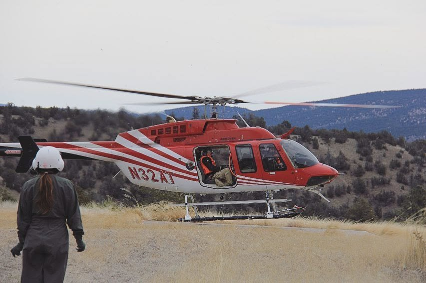{group="mexican-wolf" fig-alt="A helicopter lifting off for Mexican wolf captures while Megan, in a flight suit and helmet, watches."}
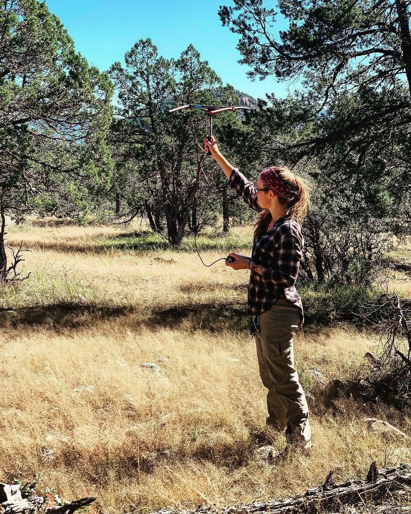{group="mexican-wolf" fig-alt="Megan holding a radio-telemetry antenna overhead in a pine and juniper forest."}
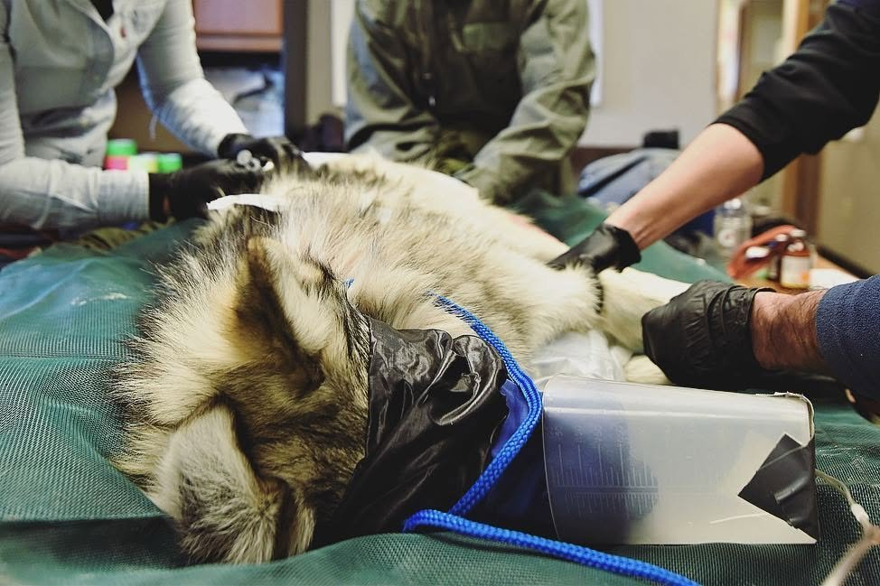{group="mexican-wolf" fig-alt="A sedated, blindfolded Mexican wolf on an exam table during a health check."}
:::

**Isle Royale Wolf Introduction Research Technician** · SUNY College of Environmental Science and Forestry, Isle Royale National Park, Michigan · May to Aug 2019
: Investigated more than 100 wolf GPS-cluster sites during the first year of wolf reintroduction, identifying prey remains and sampling moose, snowshoe hare, and beaver; collected wolf, fox, and marten scats and ran trail cameras on carcasses and trails.

**Elk Calf Survival Study Technician** · New Mexico Department of Game and Fish, Mount Taylor, New Mexico · May to Sep 2018
: Captured 35 elk calves from the ground and by helicopter, ran ground and aerial telemetry, and conducted sixteen mortality investigations to evaluate the effects of coyote management on calf survival.

::: {.photo-strip}
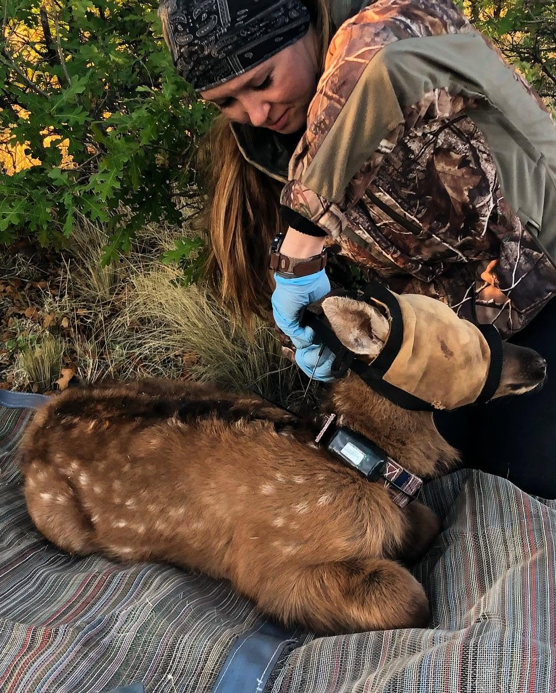{group="nm-elk" fig-alt="Megan fitting a GPS collar on a blindfolded elk calf."}
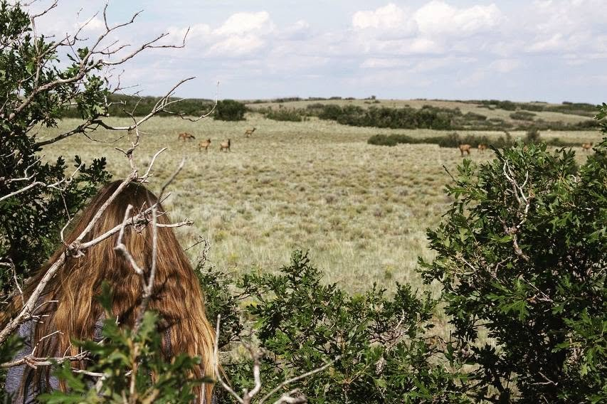{group="nm-elk" fig-alt="Elk grazing in an open grassland, seen from behind shrubs."}
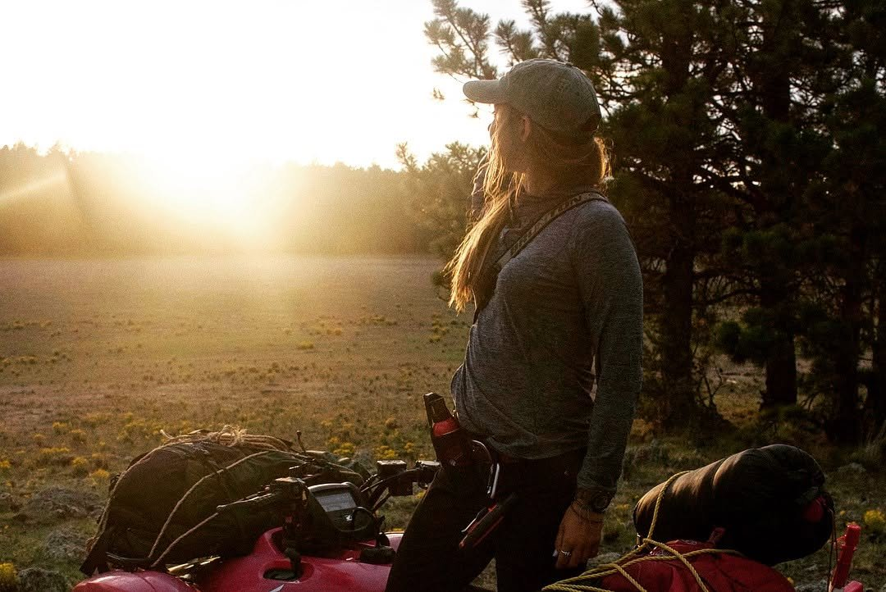{group="nm-elk" fig-alt="Megan standing beside a loaded ATV at sunrise."}
:::

**Advanced Deer, CWD, and Predator-Prey Research Technician** · Wisconsin Department of Natural Resources, Dodgeville, Wisconsin · Nov 2017 to May 2018
: Led a live-capture team that immobilized, collared, and sampled more than 100 adult deer for chronic wasting disease and predator-prey research; ran bobcat trapping, mortality investigations, and landowner outreach.

::: {.photo-strip}
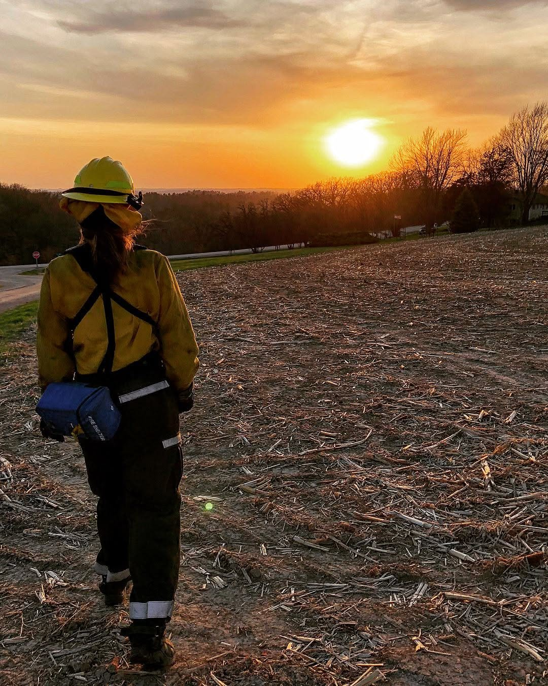{group="wisconsin" fig-alt="Megan in wildland fire gear walking across a field at sunset."}
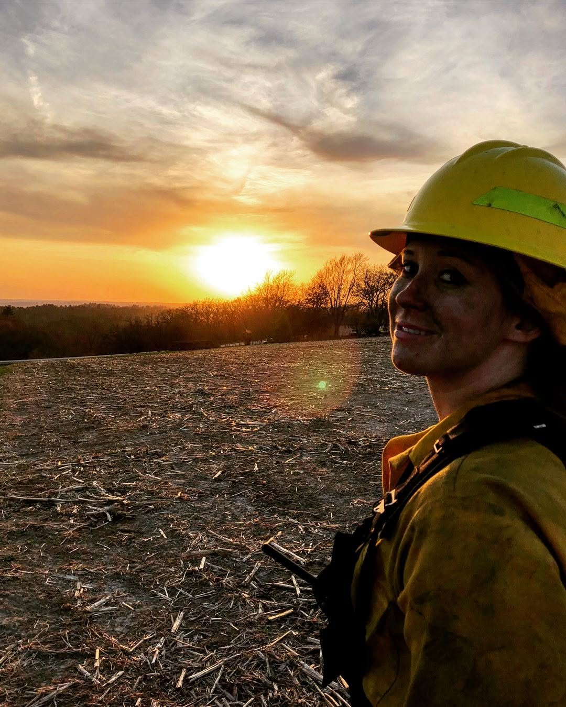{group="wisconsin" fig-alt="Megan in a fire helmet, smiling, with the sun setting behind her."}
:::

[Spring fire work during the Wisconsin project.]{.strip-caption}

**Carnivore/Deer Wildlife Technician** · Mississippi State University, Baraga, Michigan · Apr to Nov 2017
: Surveyed seven species in Michigan's Upper Peninsula (coyote howl surveys as lead technician, bear and bobcat hair snares, deer cameras, grouse, beaver, and hare surveys); captured and collared deer, black bears, bobcats, coyotes, and wolves; and investigated fawn and adult deer mortalities.

::: {.photo-strip}
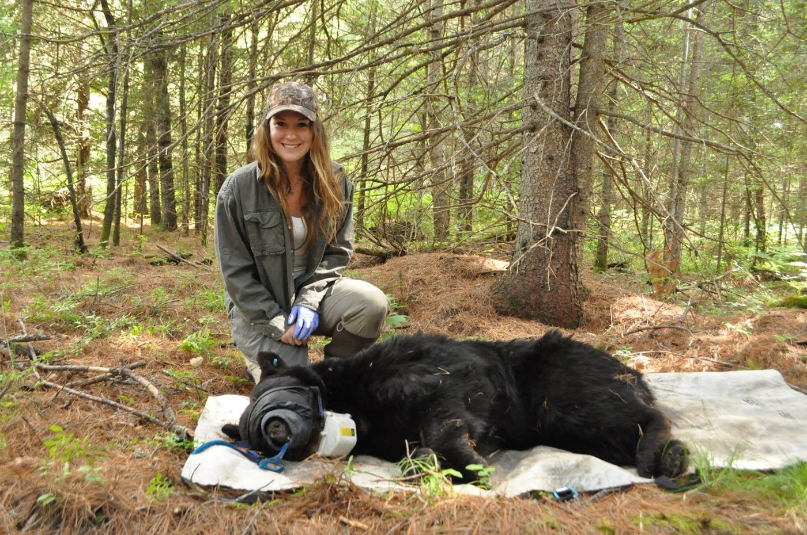{group="michigan" fig-alt="Megan kneeling beside a sedated, collared black bear in a conifer forest."}
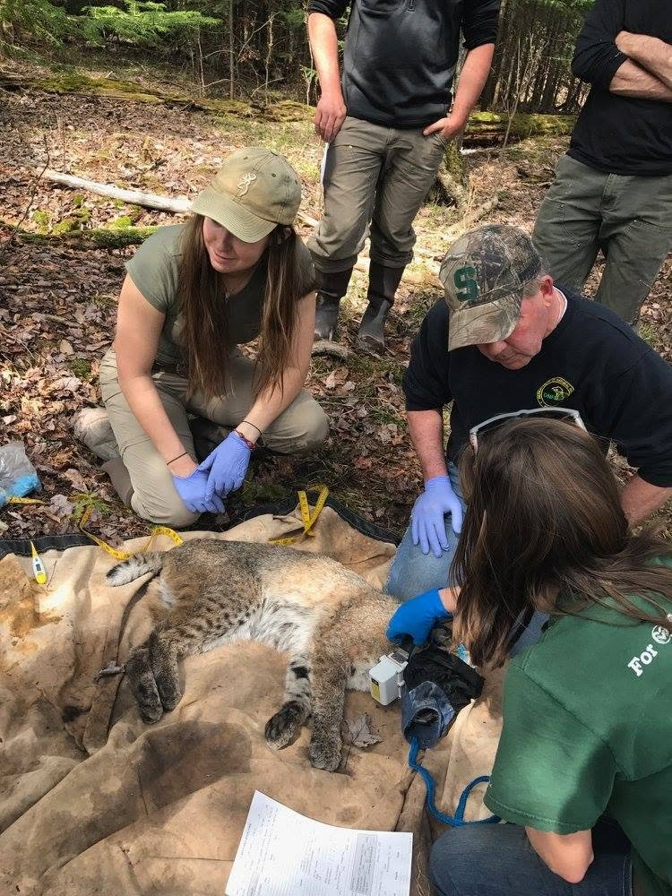{group="michigan" fig-alt="Megan helping process a sedated bobcat on a tarp."}
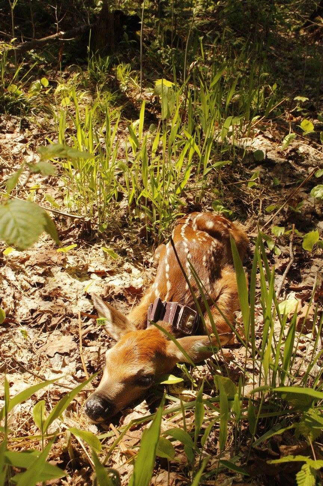{group="michigan" fig-alt="A collared white-tailed deer fawn bedded in spring grass."}
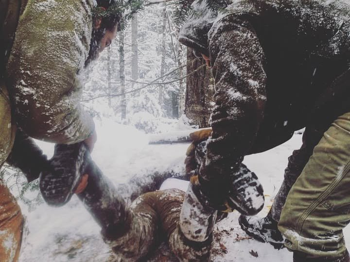{group="michigan" fig-alt="Two crew members pulling Megan out of a wolf den by her boots in falling snow."}
:::

**Wildlife Monitoring Technician** · Lake County Forest Preserves, Lake County, Illinois · May to Nov 2016
: Trapped and processed reptiles, amphibians, fish, small mammals, and mesocarnivores; radio-tracked endangered Blanding's turtles and helped with their head-start program.

**Odonate Researcher** · McHenry County College and McHenry County Conservation District, Illinois · Nov 2015 to Nov 2017
: Surveyed dragonfly nymphs across northern Illinois, adding four species to the county record, and helped confirm two sites of the federally endangered Hine's emerald dragonfly.

## Lab research

**Neuroscience Laboratory Research Intern** · Dr. Curt Freed's laboratory, Anschutz Medical Campus, Aurora, Colorado · Aug to Nov 2014
: Worked toward purifying a dopaminergic cell line to improve a cell culture model of Parkinson's disease, using cell culture, immunohistochemistry, Western blots, luciferase assays, and qPCR. Presented a poster at the Department of Medicine Research Day (Oct 2014).

## Skills from the field

Multi-platform tracking (fixed-wing, helicopter, watercraft, snow travel, and extended backcountry travel), live-capture and chemical immobilization, telemetry, remote cameras, GPS-cluster investigations, necropsies, and biological sampling. I have also worked wildland fire assignments alongside several field projects as a qualified wildland firefighter (FFT2). See my [CV](cv.qmd) for certifications.

[Photos by Megan Petersohn and field colleagues.]{.strip-caption}
