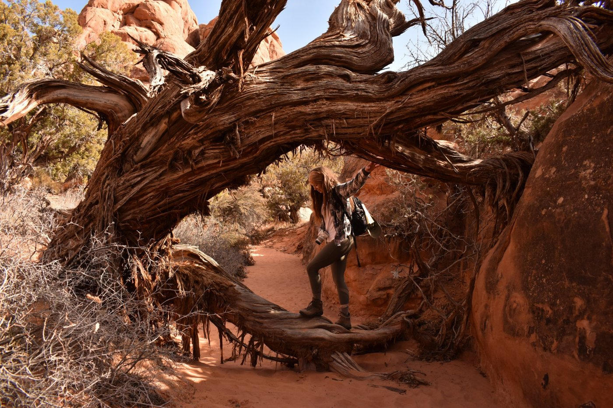

```{=html}
<section class="hero column-screen-inset">
  <div class="hero-text">
    <p class="hero-eyebrow">Wildlife ecologist</p>
    <h1 class="hero-name">Megan Petersohn</h1>
    <ul class="hero-facts">
      <li><i class="bi bi-briefcase"></i><span>Applied Ecologist<br>SwampDonkey</span></li>
      <li><i class="bi bi-mortarboard"></i><span>M.Sc. Biology Student<br>The University of British Columbia<br>Okanagan Campus</span></li>
      <li><i class="bi bi-geo-alt"></i><span>Syilx Okanagan<br>Nation Territory</span></li>
    </ul>
    <div class="hero-buttons">
      <a class="hero-btn" href="experience.html">Field experience</a>
      <a class="hero-btn hero-btn-ghost" href="cv.html">CV</a>
    </div>
  </div>
  <div class="hero-photo">
    
  </div>
</section>
```

## About

I am broadly interested in how large mammals move, interact, and coexist across working landscapes, integrating spatial ecology, predator-prey dynamics, and human-wildlife interactions to inform conservation and management. I work as an Applied Ecologist with SwampDonkey and am completing my M.Sc. at the University of British Columbia Okanagan on white-tailed deer range expansion in the Columbia Mountains. Before graduate school, I worked on wolf and predator-prey projects across North America, including the Wolf and Deer Project in Minnesota, Isle Royale, Yellowstone, and the Mexican Wolf Recovery Program.

## Current work

- [Wolf pup survival in northeastern Minnesota](projects/snf-wolf-pups/index.qmd): how long radio-collared wolf pups survived, what killed them, and why, from five decades of telemetry data. Presented at the International Wolf Symposium, 2026.
- [White-tailed deer range expansion](projects/wtd-expansion/index.qmd): what is driving white-tailed deer into the Columbia Mountains of British Columbia.

## Contact and profiles

- Email: <megan.c.petersohn@gmail.com>
- ORCID: [0000-0002-8955-9980](https://orcid.org/0000-0002-8955-9980)
- [Google Scholar](https://scholar.google.com/citations?user=bjq4MwMAAAAJ)
- [GitHub](https://github.com/meganpetersohn)
- [Field experience](experience.qmd) and [CV](cv.qmd)
