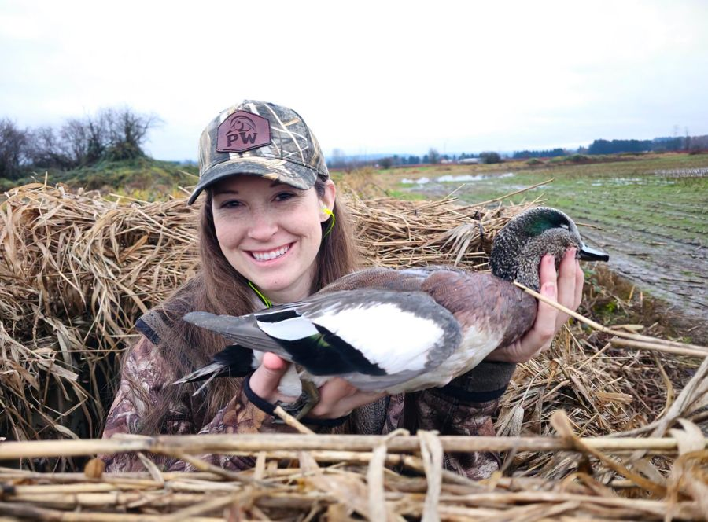
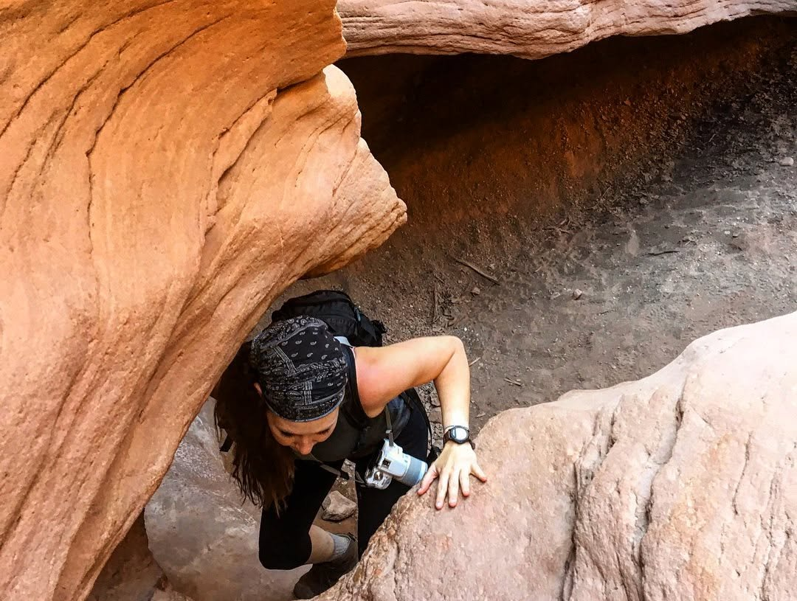
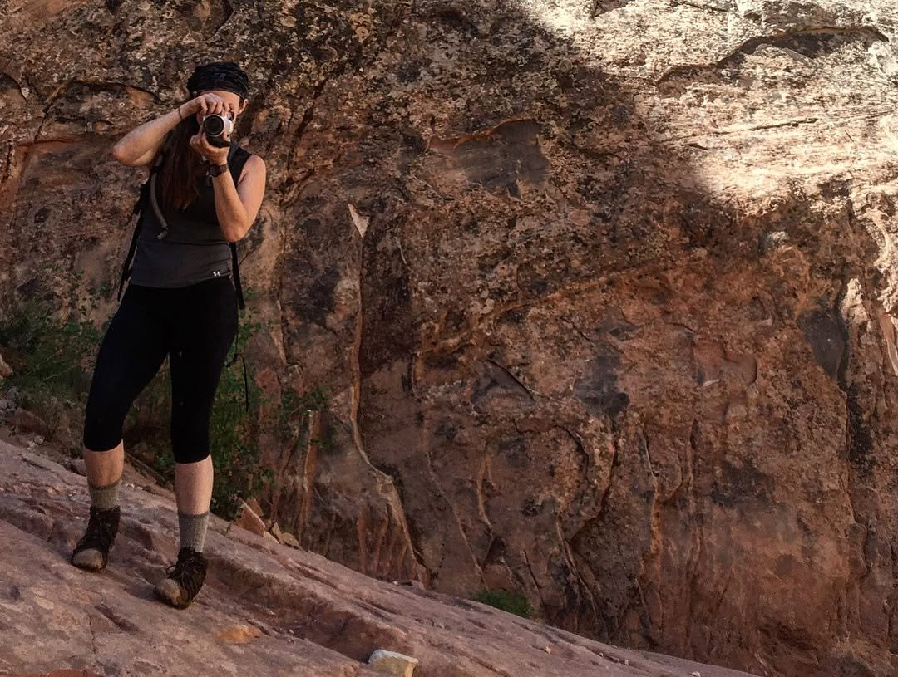
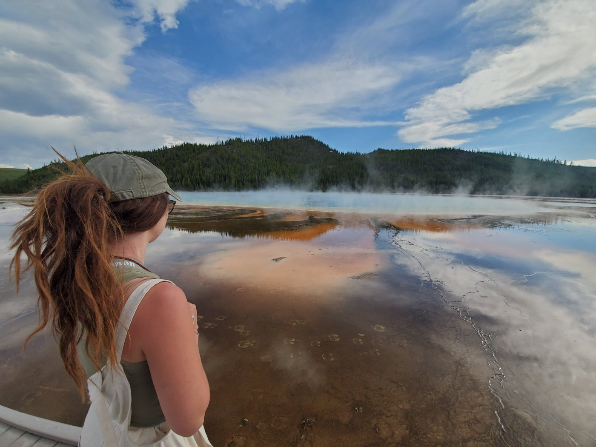
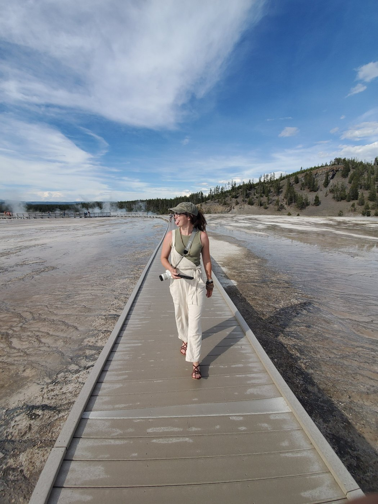
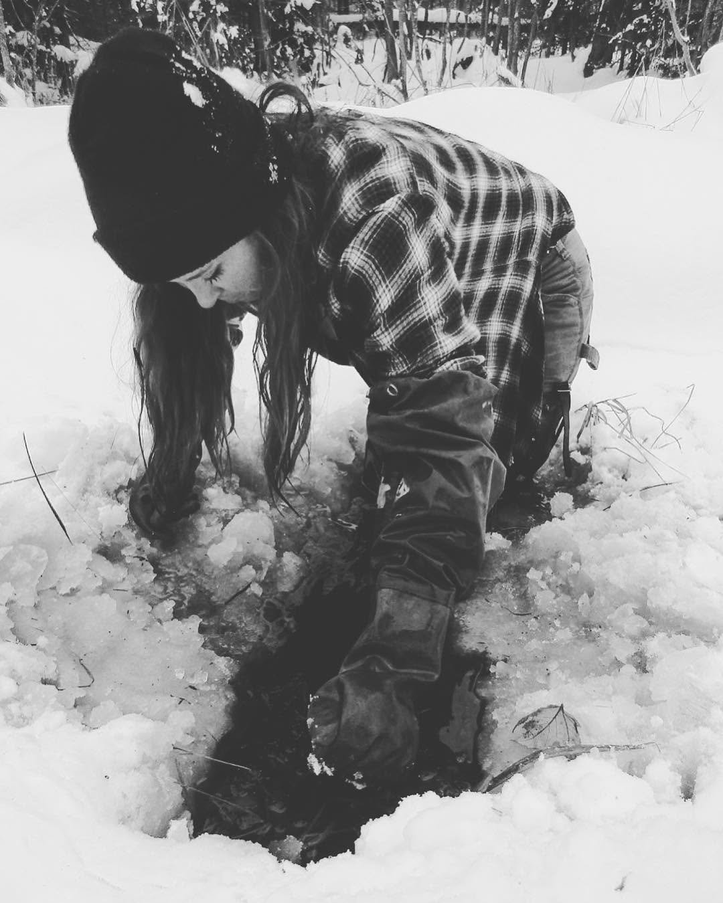

## Features and recognition

::: {.media-card}
{fig-alt="Megan smiling in a duck blind, holding an American wigeon."}

::: {.media-text}
### Mentor recognition, Delta Waterfowl Foundation
Delta Waterfowl Foundation · July 2026

Recognized for two years of mentoring UBC Okanagan students through Delta Waterfowl's University Hunting Program: helping new hunters prepare for their first hunt, loaning gear, and mentoring in the field, along with introductions to fishing, trapping, archery, and turkey hunting.

> "Megan has made hunting more accessible while building confidence in the field."

[Read the post on Facebook](https://www.facebook.com/story.php?story_fbid=1460829489422035&id=100064849926108)
:::
:::

::: {.media-card}
::: {.media-text}
### Processing wolf scats for diet analysis
Wolves and the Isle Royale Environment (Facebook) · March 2020

Featured with Talia Schwelling for bagging and washing 125 wolf scats from Isle Royale, so researchers could identify the hair and bone inside and fill in the small prey that GPS-cluster searches tend to miss.
:::
:::

::: {.media-card}
::: {.media-text}
### "Wolf Watch"
Albuquerque Journal · February 2020

Photo feature on the annual helicopter count and captures for Mexican wolf recovery in Arizona and New Mexico, including our capture crew.
:::
:::

::: {.media-card}
::: {.media-text}
### Flight operations begin for Mexican wolf population survey
White Mountain Independent · January 2020

Pictured carrying a sedated Mexican wolf to the exam room in Alpine, Arizona, during the 2019 population count (photo by Trudy Balcom; captioned "Megan Peterson").

[Read the article](https://www.wmicentral.com/news/latest_news/flight-operations-to-begin-for-mexican-wolf-population-survey/article_673490e3-8991-53eb-a091-93e9bc72d012.html)
:::
:::

::: {.media-card}
::: {.media-text}
### Isle Royale wolf relocation
U.S. National Park Service

Pictured sampling wolf scat at a GPS cluster site with Cara Ratterman in spring 2019, during the first year of wolf relocation to Isle Royale National Park.

[Read the NPS article](https://www.nps.gov/articles/000/isle-royale-wolf-relocation.htm)
:::
:::

::: {.media-card}
::: {.media-text}
### Southwest CWD, Deer and Predator Study
Wisconsin Department of Natural Resources (Facebook) · December 2017 to April 2018

Featured with the field crew in the DNR's posts on the first deer collared that winter and the wrap-up of the 2018 trapping season, when the crew collared 194 adult deer, bringing the project total to 328.

[About the study](https://dnr.wisconsin.gov/topic/research/projects/dpp/index) · [Project newsletter](https://dnr.wi.gov/topic/research/articles/november2018.html)
:::
:::

## Articles

- Petersohn, M. 2023. An old place with new songs. *International Wolf* 33(3):28-30.
- Petersohn, M.C., and S.M. Barber-Meyer. 2022. A rare window into an ancient struggle. *International Wolf* 32(2):26-27. [USGS record](https://pubs.usgs.gov/publication/70232261)

## Off the clock

::: {.photo-strip}
{group="personal" fig-alt="Megan climbing up through a red sandstone slot canyon."}
{group="personal" fig-alt="Megan photographing from a sandstone ledge."}
{group="personal" fig-alt="Megan looking out over the steaming, orange-rimmed Grand Prismatic Spring in Yellowstone."}
{group="personal" fig-alt="Megan laughing on a boardwalk across a Yellowstone geyser basin, camera in hand."}
{group="personal" fig-alt="Black-and-white photo of Megan reaching through broken ice to set a beaver trap in deep snow."}
:::

[Hiking canyon country with my dad, wandering Yellowstone's geyser basins, and trapping beaver in winter.]{.strip-caption}
