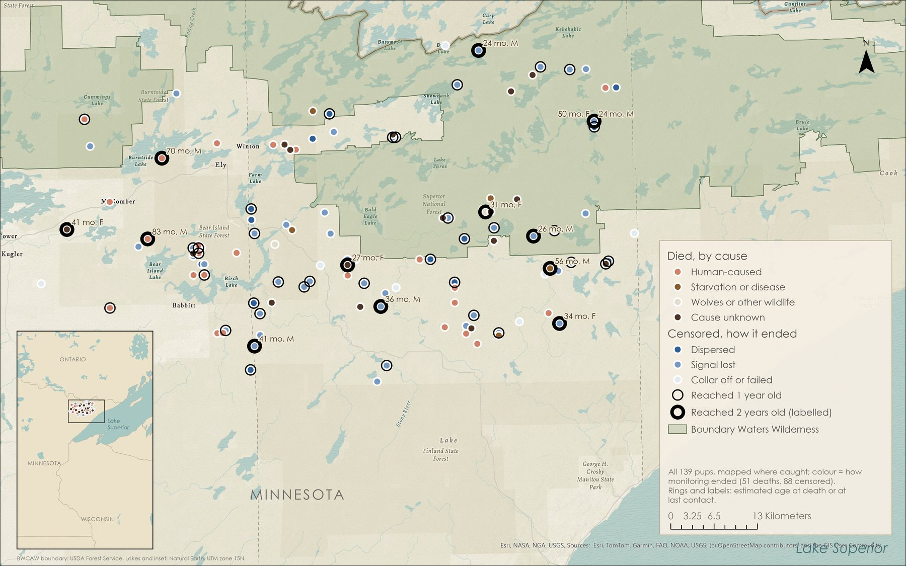
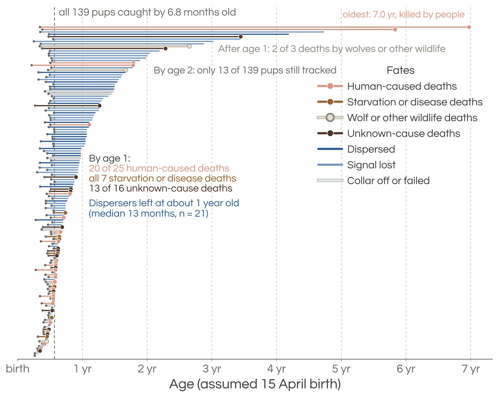
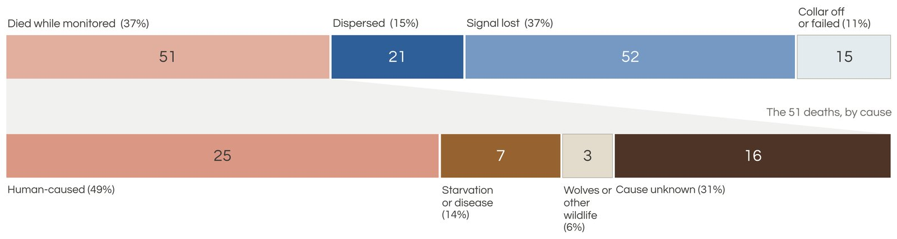
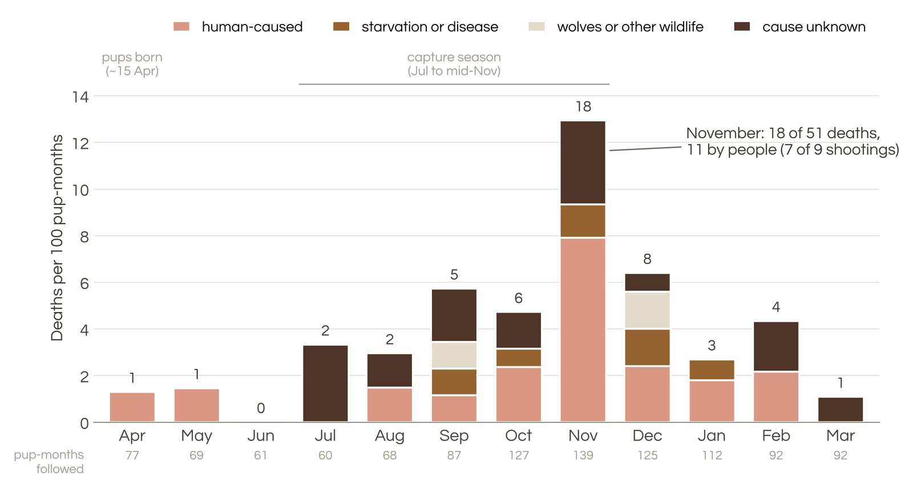
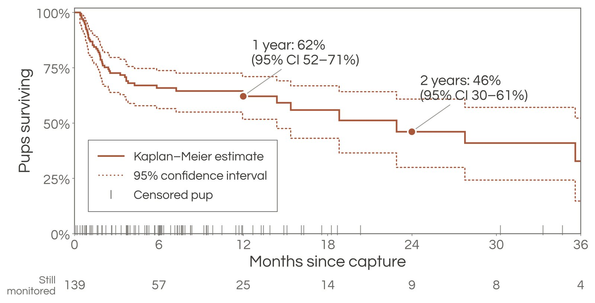
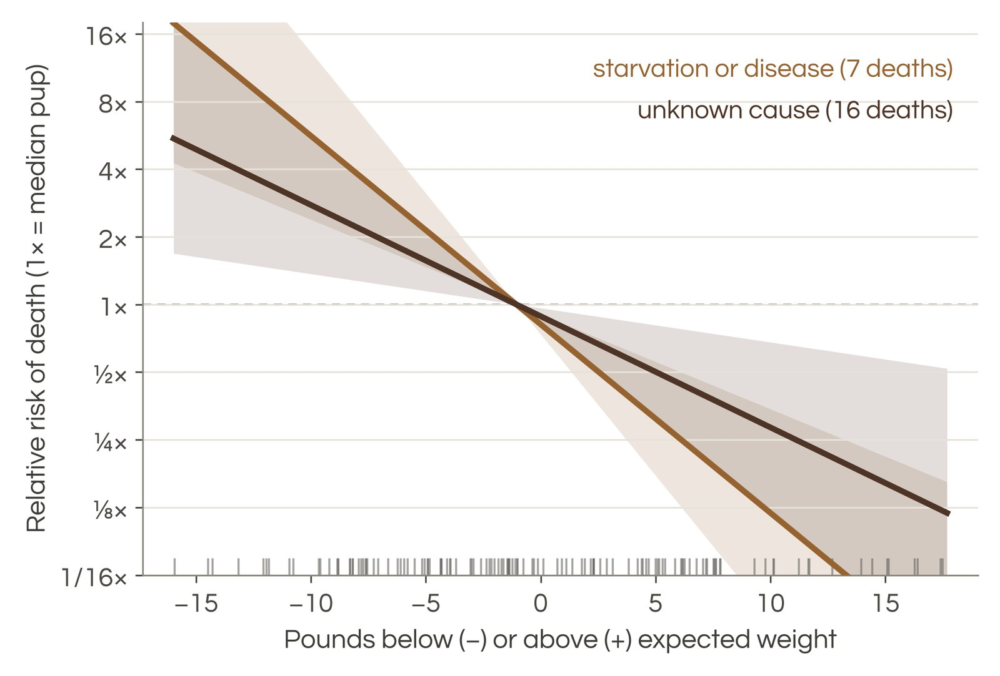
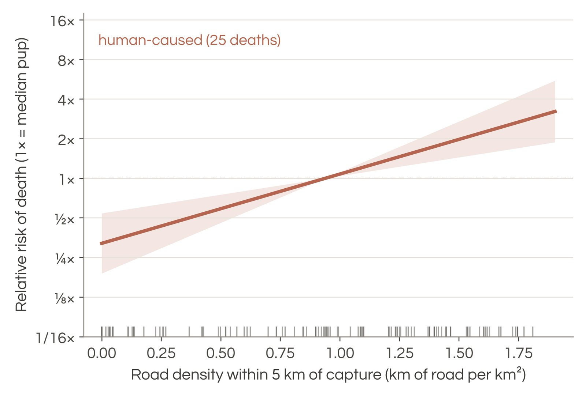
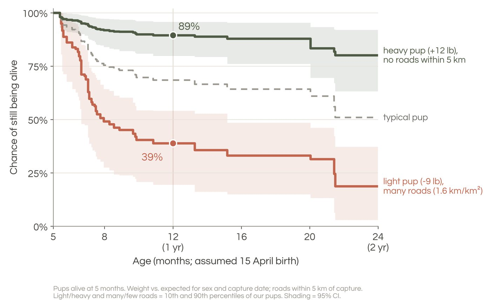
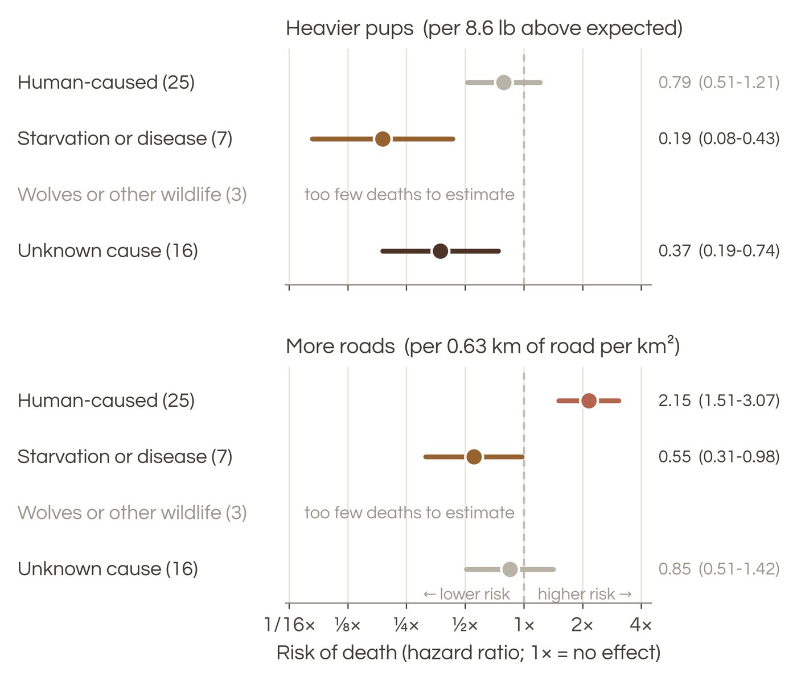
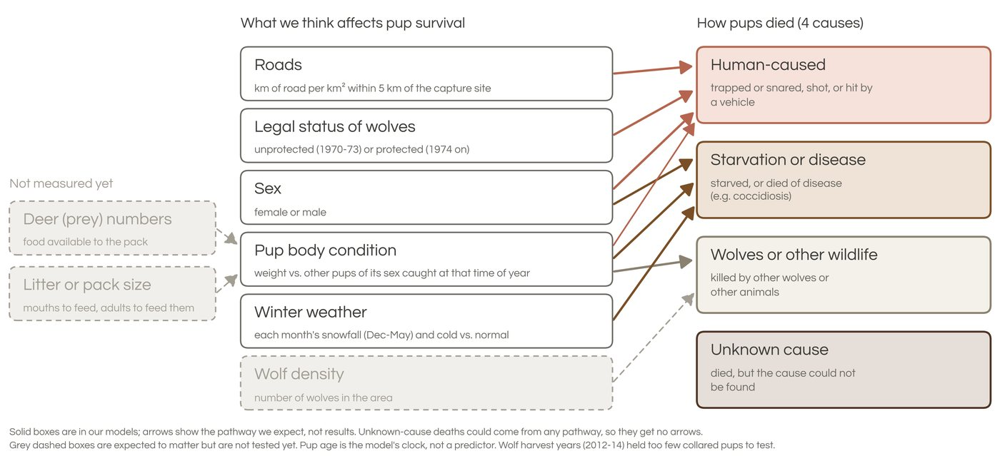

Analysis by Megan Petersohn, University of British Columbia Okanagan. Data from Mech 2009, 2022, Barber-Meyer et al. 2021, U.S. Geological Survey.

::: {.prelim}
Preliminary results. Numbers may change as the analysis is finalized for publication.
:::

## The Superior National Forest wolf study

Beginning in the late 1960s, L. David Mech and colleagues with the U.S. Geological Survey radio-tracked wolves in the Superior National Forest of northeastern Minnesota, one of the longest-running wolf studies anywhere (Mech 2009, 2022; Barber-Meyer et al. 2021). It included some of the earliest radio-collaring of wolf pups. This poster revisits 139 of those pups, collared from 1970 to 2017, to ask when and how they died, how many survived their first two years, and what factors shaped their survival.

## At a glance

::: {.glance}

<b>62%</b>survived their first year after capture (46% to 2 years)

<b>25 of 51</b>deaths were caused by people

<b>7 of 7</b>starvation or disease deaths came before age 1

<b>November</b>deadliest month: 18 of 51 deaths, including 7 of 9 shootings

:::

## Methods in brief

- **Study area.** Superior National Forest, northeastern Minnesota, USA. Pups radio-collared by the USGS Wolf and Deer Project, 1970 to 2017.
- **Pups.** 343 pup captures. 150 pups were collared once, caught between 22 June and 15 November, with a known monitoring history. The 11 deaths linked to capture or the collar were removed, leaving 139 pups.
- **Fates.** 51 pups died while monitored. 88 were censored at last contact: they dispersed, their signal was lost, their collar came off or failed, or monitoring ended. Pups that dispersed and were later found dead count as censored at last contact.
- **Causes.** Four groups: human-caused (25), starvation or disease (7), wolves or other wildlife (3), and cause unknown (16). A cause recorded only as "possible" or "probable" counts as unknown.
- **Survival.** Kaplan-Meier survival from the day of capture, and cumulative incidence of each cause (R package `survival`).
- **Cox models.** One cause-specific Cox model per cause group, on pup age (all pups assumed born 15 April; each pup enters at the age it was caught). Predictors were weight compared with what is expected for a pup of its sex caught on that date, and road density within 5 km of the capture site. Standard errors are clustered by litter; 134 pups had both predictors.

### The 25 human-caused deaths

12 were illegal (7 shot, 5 trapped or snared), 7 were accidental (6 hit by a vehicle or snowmobile, 1 caught by a fox trapper), 2 were legal (1 trapped in 1973, 1 in the 2013 harvest), and 4 had no legality recorded.

## Figures

::: {.plate}
{fig-alt="Map of the study area around Ely, Minnesota, showing all 139 pups at their capture sites."}
:::
**Fig. 1.** Pups were caught across the study area, both inside and outside the Boundary Waters Wilderness (shaded green). Each dot marks one pup's capture site and is coloured by cause of death (51 pups) or by how monitoring ended (88 pups). Thin rings mark pups that reached 1 year old, and thick rings mark those that reached 2 years, labelled with estimated age at death or last contact, and sex.

::: {.plate}
{fig-alt="One line per pup from age at capture to death or last contact, coloured by fate."}
:::
**Fig. 2.** Of the 51 deaths, 41 occurred before age 1. Each line follows one pup from its age at capture to its age at death (dot) or last contact, coloured by fate. The dashed line shows that every pup had been caught by 6.8 months of age.

::: {.plate}
{fig-alt="Stacked bars of how monitoring ended and the 51 deaths by cause."}
:::
**Fig. 3.** People caused half of all deaths. The top bar shows how monitoring ended for 139 pups: 51 died, and 88 dispersed, lost signal, or lost their collar. The bottom bar breaks the 51 deaths down by cause. The 11 pups that died from capture or collar-related causes are not included.

::: {.plate}
{fig-alt="Deaths per 100 pup-months by calendar month and cause, peaking in November."}
:::
**Fig. 4.** Deaths peaked in November, at the start of hunting and trapping seasons. Bars show deaths per 100 pup-months (one pup tracked for one month), which accounts for more pups being monitored in some months than others. Numbers above the bars are deaths, and numbers below the months are pup-months monitored. April to June bars include only pups in their second year.

::: {.plate}
{fig-alt="Kaplan-Meier survival curve over 36 months since capture."}
:::
**Fig. 5.** Survival fell fastest in the first 3 months after capture, to 73%, and then levelled off. The solid line is the Kaplan-Meier estimate for 139 pups, and dotted lines show the 95% confidence interval. Ticks mark pups whose monitoring ended without a known death, and numbers below show how many pups were still monitored.

::: {.plate}
{fig-alt="Relative risk of starvation or disease and unknown-cause death falling with pup weight."}
:::
**Fig. 6.** Lighter pups were more likely to die of starvation, disease, or unknown causes. Zero on the x axis is the weight expected for a pup of the same sex caught on the same date; the median pup was about 1 lb below expected. A pup 10 lb lighter than expected had about 6 times the median pup's risk of starving. Lines show Cox model hazard ratios, shading shows the 95% confidence interval, and ticks mark each pup's weight.

::: {.plate}
{fig-alt="Relative risk of a human-caused death rising with road density."}
:::
**Fig. 7.** Pups caught where roads were dense were more likely to be killed by people. The median road density was 0.94 km of road per km² within 5 km of capture. A pup caught where road density was 1.75 had about 2.7 times the median pup's risk. The line shows the Cox model hazard ratio, shading shows the 95% confidence interval, and ticks mark each pup's road density.

### Extra figures

::: {.plate}
{fig-alt="Predicted survival from 5 to 24 months for a light pup near many roads versus a heavy pup with no roads nearby."}
:::
**Weight and roads together.** Predicted chance that a pup alive at 5 months is still alive, from the four cause-specific Cox models. A light pup caught among many roads had a 39% chance (95% CI 19 to 54%) of being alive at 1 year; a heavy pup with no roads within 5 km, 89% (80 to 96%); a typical pup, about 69%. Light and heavy, and many and few roads, are the 10th and 90th percentiles of our pups. Shading shows 95% confidence intervals from 400 bootstrap samples of litters.

::: {.plate}
{fig-alt="Hazard ratios per standard deviation of weight and road density for each cause of death."}
:::
**What each predictor did to each cause of death.** Hazard ratios per 1 standard deviation (8.65 lb of weight; 0.63 km of road per km²), with 95% confidence intervals. Grey marks show no clear effect. Wolves or other wildlife (3 deaths) were too few to estimate.

::: {.plate}
{fig-alt="Diagram of factors expected to affect each cause of death."}
:::
**What we think affects pup survival.** Solid boxes are in our models; arrows show the pathway we expect, not results. Grey dashed boxes are expected to matter but are not tested yet.

## Conclusion

Deaths came early: 43 of the 51 occurred within a year of capture (34 within three months), and 18 fell in November alone. People caused half of all deaths (25 of 51), followed by unknown causes (16), starvation or disease (7), and wolves or other wildlife (3). Overall, 62% of pups survived their first year after capture and 46% their second. Pups caught where roads were dense were more often killed by people, and lighter pups were more likely to starve or die of unknown causes. Only 3 collared pups were tracked during the 2012 to 2014 harvest seasons (1 killed legally), too few to test harvest effects. Accounting for pups lost from monitoring raised 1-year survival from our abstract's preliminary 43% to 62%.

**Next steps.** Test whether deer abundance and winter severity explain year-to-year differences in pup survival, and use last known locations to tell dispersers from deaths among the 52 pups whose signal was lost, sharpening survival estimates. A manuscript is in preparation.

## Credits and how it was made

- **Data.** Collected by the U.S. Geological Survey Wolf and Deer Project in the Superior National Forest, led by L. David Mech and Shannon Barber-Meyer. Many technicians, pilots, and volunteers captured and radio-tracked these pups from 1970 to 2017.
- **Analysis and poster.** Megan Petersohn.
- **Support.** U.S. Geological Survey (most of this work), UBC Okanagan (WEiRG), and Swamp Donkey Solutions.
- **Statistics.** R, with the `survival` package (Kaplan-Meier survival and Cox proportional hazards models).
- **Data and figures.** Python (pandas, NumPy, matplotlib), with the Questrial typeface and a colour-blind-checked palette.
- **Map.** ArcGIS Pro. Boundary Waters Canoe Area Wilderness boundary from the USDA Forest Service; lakes and inset from Natural Earth; basemap from Esri and its data partners.
- **Poster design.** Canva, including design elements from Canva's library. Wolf illustrations from Adobe Stock, used under license.
- **AI assistance.** I used Claude, an AI assistant made by Anthropic, to help write and debug the analysis and figure code, check numbers against the dataset, and draft and edit text, including this page. I directed the analysis, made the analytical decisions, and reviewed all results and wording.
- **Place.** This research took place within the traditional, ancestral, and contemporary homelands of the Anishinaabe (Ojibwe) and Dakota Peoples, on lands ceded in the 1854 Treaty of La Pointe, where the Bois Forte, Grand Portage, and Fond du Lac Bands of Lake Superior Chippewa retain treaty rights.

## References

- Barber-Meyer, S. M., T. J. Wheeldon, and L. D. Mech. 2021. The importance of wilderness to wolf (*Canis lupus*) survival and cause-specific mortality over 50 years. Biological Conservation 258:109145. <https://doi.org/10.1016/j.biocon.2021.109145>
- Gese, E. M., and L. D. Mech. 1991. Dispersal of wolves (*Canis lupus*) in northeastern Minnesota, 1969-1989. Canadian Journal of Zoology 69:2946-2955. <https://doi.org/10.1139/z91-415>
- Hynes, A., T. D. Gable, A. T. Homkes, J. K. Bump, and J. G. Bruggink. 2026. Born to die: pack and population level estimates of wolf pup survival and recruitment in the Greater Voyageurs Ecosystem. Wildlife Biology 2026:e01562. <https://doi.org/10.1002/wlb3.01562>
- Mech, L. D. 1977. Productivity, mortality, and population trends of wolves in northeastern Minnesota. Journal of Mammalogy 58:559-574. <https://doi.org/10.2307/1380004>
- Mech, L. D. 2009. Long-term research on wolves in the Superior National Forest. Pages 15-34 in A. P. Wydeven, T. R. Van Deelen, and E. J. Heske, editors. Recovery of gray wolves in the Great Lakes region of the United States: an endangered species success story. Springer, New York. <https://doi.org/10.1007/978-0-387-85952-1_2>
- Mech, L. D. 2022. Long-term wolf study in the Superior National Forest ends. International Wolf 32(3):12-15.

---

*This information is preliminary and is subject to revision. It is being provided to meet the need for timely best science. The information is provided on the condition that neither the U.S. Geological Survey nor the U.S. Government shall be held liable for any damages resulting from the authorized or unauthorized use of the information.*
