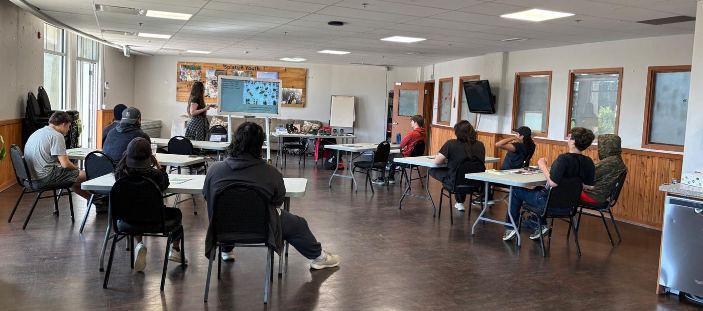
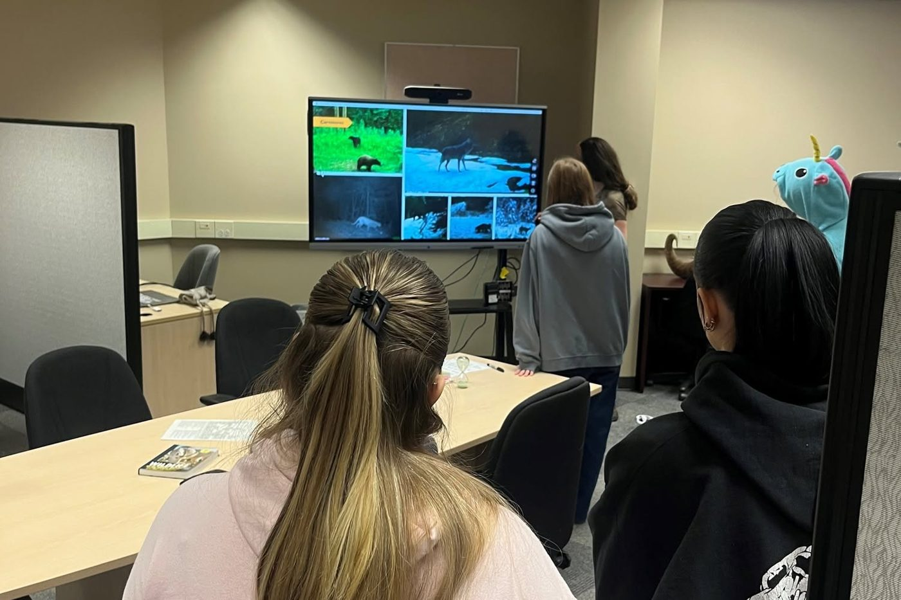
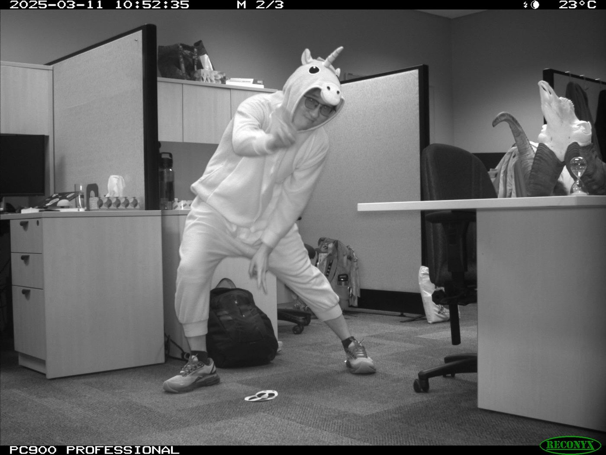

## Research mentorship

**Undergraduate Research Supervisor**, WEiRG Lab (Dr. Tal Avgar), UBC Okanagan · Sep 2024 to present
: Mentoring four undergraduate researchers in data management, wildlife photo classification, statistical analysis, and presentation and manuscript preparation, including co-mentoring an honours thesis and training students in camera-trap image tagging.

In the field, I also trained and led seasonal technicians and volunteers on many of the projects I worked on, including the Isle Royale wolf, moose, and beaver projects, the Mexican Wolf Recovery Program, and the USGS Wolf and Deer Project (see [Field experience](experience.qmd)).

## Teaching and tutoring

**Teaching Assistant, Anatomy and Physiology**, UBC Okanagan · Jan to May 2025

**Biology, Anatomy, and Physiology Tutor**, McHenry County College, Crystal Lake, Illinois · Nov 2015 to Apr 2017 and Oct 2019 to Jan 2020
: Tutored college students in biology, anatomy, and physiology, including privately tutoring about 15 students with disabilities.

## Workshops and outreach

::: {.project-card}
### Youth day with Splatsin
{fig-alt="Splatsin youth seated at tables, seen from behind, while Megan presents trail-camera research at the front of the room."}

With Adam Christian (Splatsin), talked with Splatsin youth about paths into wildlife ecology and how our deer research uses trail cameras, then went outside to look for animal sign and set up a camera. Enderby, BC · May 2026
:::

::: {.project-card}
### Camera traps in research
::: {.photo-strip}
{group="workshop" fig-alt="High school students, seen from behind, looking at camera-trap photos of wildlife on a large screen."}
{group="workshop" fig-alt="Black-and-white trail-camera photo of Liufeng Wang in a unicorn costume, posing in an office during the workshop."}
:::

[Right: Liufeng Wang, PhD candidate in the WEiRG Lab, caught on our demo camera.]{.strip-caption}

Interactive workshop for high school students on camera-trap methods, wildlife monitoring, and career pathways in conservation science. UBC Okanagan, Kelowna, BC · Mar 2025
:::

::: {.project-card}
### Radio-telemetry field training
Hands-on workshop for undergraduate students with The Wildlife Society UBCO Chapter, covering telemetry equipment, animal tracking, and spatial data collection. Kelowna, BC · Sep 2024
:::

## Student leadership

- President, UBC Okanagan Backcountry Hunters and Anglers Collegiate Club (Sep 2024 to Aug 2026)
- Founder, Augustana College Fishing Club (2014 to 2015)
